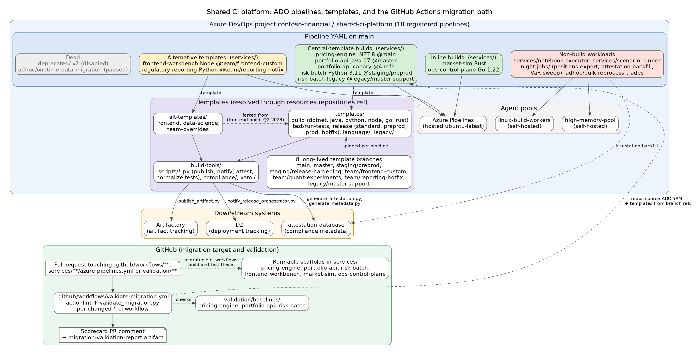

# Shared CI Platform — Enterprise Pipeline Repository

This repository contains the shared CI/CD platform configuration for the organization.
It includes build templates, release workflows, helper scripts, and service pipeline
definitions used across all engineering teams.

> **Note**: This repository has evolved organically over several years and contains
> significant technical debt including template drift, duplicate logic, and non-build
> workloads running on CI infrastructure.

## Repository Structure

```
.github/workflows/  GitHub Actions: migration validation (and migrated *-ci workflows)
templates/          Central shared build, test, and release templates
alt-templates/      Team-maintained alternative templates
build-tools/        Shared helper scripts and YAML fragments
services/           Per-service ADO pipelines and runnable service scaffolds
night-jobs/         Scheduled operational workloads
adhoc/              One-off operational pipelines
deprecated/         Old pipelines kept for reference
archive/            Archived configurations
validation/         Migration validation baselines and scripts
docs/               Platform documentation
upstream-reference/ Original upstream examples (preserved for reference)
```

## Architecture

See [docs/architecture.md](docs/architecture.md) for how pipelines, templates, agent pools,
downstream systems and migration validation fit together. The diagram below is generated from
the editable Graphviz source [docs/diagrams/architecture.dot](docs/diagrams/architecture.dot)
([SVG](docs/diagrams/architecture.svg)); run `docs/diagrams/render.sh` after editing it.



## Template Architecture

Templates are organized into several areas:

- **Central templates** (`templates/build/`, `templates/test/`, `templates/release/`) — canonical shared templates maintained by the shared-ci-platform team
- **Language setup** (`templates/language/`) — language-specific environment setup
- **Legacy templates** (`templates/legacy/`) — older template versions still in use
- **Alternative templates** (`alt-templates/`) — team-maintained forks for specialized needs
- **Build tool helpers** (`build-tools/yaml/`) — shared YAML fragments

## Branch Model

Templates are consumed via branch references. Multiple long-lived branches exist
with divergent template logic:

| Branch | Purpose |
|--------|---------|
| `main` | Canonical shared templates |
| `master` | Legacy default branch (pre-rename) |
| `staging/preprod` | Staging environment modifications |
| `staging/release-hardening` | Release workflow hardening |
| `team/frontend-custom` | Frontend team customizations |
| `team/quant-experiments` | Quant team experimental changes |
| `team/reporting-hotfix` | Compliance workflow patches |
| `legacy/master-support` | Frozen compatibility branch |

See [docs/branch-usage-notes.md](docs/branch-usage-notes.md) for details.

## Services

| Service | Stack | Template Source | Runnable scaffold |
|---------|-------|-----------------|-------------------|
| pricing-engine | .NET 8 | central templates (main) | yes |
| portfolio-api | Java 17/Maven | central templates (master; canary pins 4 refs) | yes |
| risk-batch | Python | central templates (staging/preprod; legacy pipeline on legacy/master-support) | yes |
| market-sim | Rust | custom (inline) | yes |
| ops-control-plane | Go | custom (inline) | yes |
| frontend-workbench | Node (React-style renderer) | alt-templates/frontend (team/frontend-custom) | yes |
| regulatory-reporting | Python | alt-templates/team-overrides (team/reporting-hotfix) | no (pipeline only) |
| notebook-executor | Python | none (non-build workload) | no (pipeline only) |
| scenario-runner | Python | none (non-build workload) | no (pipeline only) |

Run commands for each scaffold are in [docs/architecture.md](docs/architecture.md#running-the-scaffolds-locally).

## Documentation

- [Architecture](docs/architecture.md) — how pipelines, templates, pools and validation fit together, with diagram
- [Migration Context](docs/migration-context.md) — background on CI platform evolution
- [Branch Usage Notes](docs/branch-usage-notes.md) — branch inventory and ownership
- [Ownership Gaps](docs/ownership-gaps.md) — services with unclear ownership
- [Demo Scenarios](docs/demo-scenarios.md) — CI migration analysis scenarios
- [Validation Strategy](validation/docs/validation-strategy.md) — migration validation approach
- [Pipeline Inventory Report](docs/pipeline-inventory-report.md) — classification of all 18 pipelines for the ADO → GitHub Actions migration

## Migration Validation

Every PR to `main` that changes `.github/workflows/**`, `services/**/azure-pipelines.yml` or
`validation/**` runs the `validate-migration` workflow. For each changed `*-ci.yml` workflow it
lints with `actionlint`, compares it against the source ADO pipeline
(`validation/scripts/validate_migration.py`), and posts a scorecard comment on the PR.
Six services (`pricing-engine`, `portfolio-api`, `risk-batch`, `market-sim`, `ops-control-plane`,
`frontend-workbench`) contain runnable scaffolds, so a migrated workflow produces a real build,
test run and artifacts. Artifact and test-count baselines exist only for `pricing-engine`,
`portfolio-api` and `risk-batch`.

## Integration Points

- **Artifactory** — central artifact tracking system
- **D2** — deployment tracking and coordination
- **attestation-database** — regulatory compliance metadata and attestations
