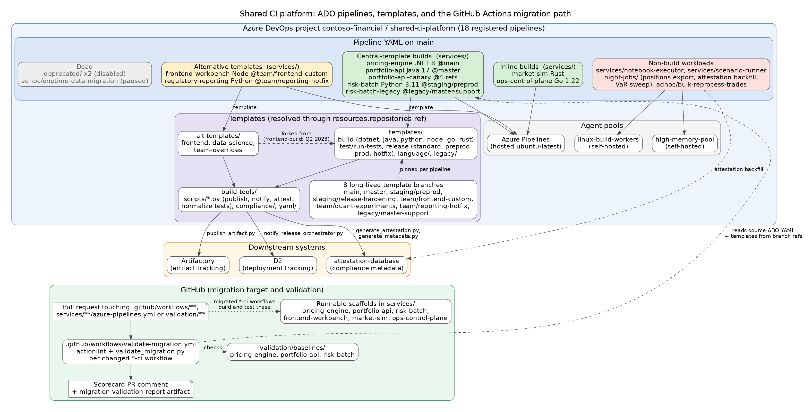

# Architecture

This page describes how the shared CI platform in this repository fits together on `main`:
which pipelines exist, which templates and agent pools they use, which downstream systems they
reach, and how the GitHub Actions migration is validated. For the per-pipeline classification
(migrate / do not migrate / dead) see the [Pipeline Inventory Report](pipeline-inventory-report.md).

The diagram source is [`diagrams/architecture.dot`](diagrams/architecture.dot) (Graphviz). Edit it
and run [`diagrams/render.sh`](diagrams/render.sh) to regenerate
[`architecture.png`](diagrams/architecture.png) and [`architecture.svg`](diagrams/architecture.svg).

## Layers

| Layer | Location | Role |
|---|---|---|
| Pipeline definitions | `services/*/azure-pipelines*.yml`, `night-jobs/*/`, `adhoc/`, `deprecated/` | 18 YAML entrypoints registered in the ADO project `contoso-financial / shared-ci-platform` |
| Central templates | `templates/build/`, `templates/test/`, `templates/release/`, `templates/language/`, `templates/legacy/` | Canonical build (dotnet, java, python, node, go, rust), test, release (standard, preprod, prod, hotfix) and language-setup steps |
| Alternative templates | `alt-templates/frontend/`, `alt-templates/data-science/`, `alt-templates/team-overrides/` | Team-maintained forks; `frontend-build.yml` diverged from `templates/build/build-node.yml` in Q2 2023 |
| Build tools | `build-tools/scripts/`, `build-tools/compliance/`, `build-tools/yaml/`, `build-tools/release/` | Python helpers and YAML fragments the templates call to publish artifacts, notify releases and write attestations |
| Service scaffolds | `services/<name>/src`, `tests`, project files | Small runnable codebases so migrated workflows produce real builds, tests and artifacts |
| Migration validation | `.github/workflows/validate-migration.yml`, `validation/` | GitHub Actions check that compares a migrated workflow with its source ADO pipeline |
| Reference only | `archive/`, `upstream-reference/` | Not registered pipelines; `archive/old-release-workflow.yml` is the one unregistered pipeline-shaped file |

## How a service pipeline resolves its templates

Service pipelines declare the template repository under `resources.repositories` with alias
`templates`, `name: shared-ci-platform` and a branch `ref`, then call
`- template: <path>@templates`. The template code that runs therefore comes from the branch the
pipeline pins, not from `main`. Eight long-lived branches exist (see
[Branch Usage Notes](branch-usage-notes.md)); the pins on `main` are:

| Pipeline | Template source | Ref |
|---|---|---|
| `services/pricing-engine/azure-pipelines.yml` | central | `main` |
| `services/portfolio-api/azure-pipelines.yml` | central | `master` |
| `services/portfolio-api/azure-pipelines-canary.yml` | central | `main`, `master`, `staging/preprod`, `staging/release-hardening` (one alias each) |
| `services/risk-batch/azure-pipelines.yml` | central | `staging/preprod` |
| `services/risk-batch/azure-pipelines-legacy.yml` | central (legacy) | `legacy/master-support` |
| `services/frontend-workbench/azure-pipelines.yml` | `alt-templates/frontend` | `team/frontend-custom` |
| `services/regulatory-reporting/azure-pipelines.yml` | `alt-templates/team-overrides` | `team/reporting-hotfix` |
| `services/market-sim/azure-pipelines.yml` | none (inline steps) | — |
| `services/ops-control-plane/azure-pipelines.yml` | none (inline steps) | — |
| `services/notebook-executor/azure-pipelines.yml` | none (non-build workload) | — |
| `services/scenario-runner/azure-pipelines.yml` | none (non-build workload) | — |
| `deprecated/old-pricing-pipeline.yml` | central (legacy) | `legacy/master-support` |

No pipeline on `main` pins `team/quant-experiments`.

## Services

| Service | Stack | Runnable scaffold | Pipeline kind | Agent pool |
|---|---|---|---|---|
| pricing-engine | .NET 8 ASP.NET Core API (`/api/pricing/catalog`, `/calculate`, `/bulk`, `/health`) | yes, xUnit tests | build + release | hosted `ubuntu-latest` |
| portfolio-api | Java 17 / Maven library + CLI | yes, JUnit tests | build + release (plus canary) | hosted `ubuntu-latest` |
| risk-batch | Python historical VaR / expected shortfall | yes, `unittest` | build + release (plus legacy) | hosted (`ubuntu-latest`, legacy `ubuntu-20.04`) |
| market-sim | Rust simulation library + CLI | yes, `cargo test` | inline build | hosted `ubuntu-latest` |
| ops-control-plane | Go HTTP server (`/healthz`, `/v1/controls`, `/v1/controls/{id}`) | yes, `go test` | inline build | hosted `ubuntu-latest` |
| frontend-workbench | Node, dependency-free React-style renderer with client and SSR build scripts | yes, `node --test` | alt-template build + deploy | hosted `ubuntu-latest` |
| regulatory-reporting | Python compliance reporting | no (pipeline only; sources it calls are not in the repo) | compliance workflow on CI | hosted `ubuntu-latest` |
| notebook-executor | Python notebooks | no (pipeline only) | non-build, scheduled | `linux-build-workers` |
| scenario-runner | Python scenario compute | no (pipeline only) | non-build, scheduled | `high-memory-pool` |

Owners per service are tracked in [Ownership Gaps](ownership-gaps.md).

## Scheduled and one-off workloads

| Path | What it does | Pool |
|---|---|---|
| `night-jobs/business/daily-positions-export.yml` | Exports and distributes daily positions | `linux-build-workers` |
| `night-jobs/compliance/attestation-backfill.yml` | Scans for and backfills missing attestations in attestation-database | `linux-build-workers` |
| `night-jobs/compute/var-scenario-sweep.yml` | Nightly VaR scenario sweep and result upload | `high-memory-pool` |
| `adhoc/bulk-reprocess-trades.yml` | Manual trade reprocessing | hosted |
| `adhoc/onetime-data-migration.yml` | One-time migration (paused, classified dead) | hosted |
| `deprecated/*.yml` | Disabled legacy pipelines kept for reference | hosted `ubuntu-20.04` |

These are operational jobs that use CI as a scheduler; the inventory classifies them as
*do not migrate* (or dead) rather than as GitHub Actions build candidates.

## Downstream systems

| System | Reached through |
|---|---|
| Artifactory | `build-tools/scripts/publish_artifact.py`, called from the central build templates |
| D2 | `build-tools/scripts/notify_release_orchestrator.py`, called from `templates/release/release-standard.yml` |
| attestation-database | `build-tools/scripts/generate_attestation.py`, `build-tools/compliance/generate_metadata.py`, and the attestation backfill night job |

## Migration validation

`.github/workflows/validate-migration.yml` runs on pull requests to `main` that touch
`.github/workflows/**`, `services/**/azure-pipelines.yml` or `validation/**`, and on manual dispatch.

1. It lints changed workflows with `actionlint`.
2. It maps each changed `<name>-ci.yml` workflow to its service and source ADO pipeline
   (`pricing-engine`, `portfolio-api`, `risk-batch` / `risk-batch-legacy`, `market-sim`,
   `ops-control-plane`, `frontend-workbench`, `regulatory-reporting`).
3. `validation/scripts/validate_migration.py` expands the ADO templates and checks YAML syntax,
   triggers, stage/job mapping, environment gates, integration points, and the artifact and
   test-count baselines in `validation/baselines/`.
4. The workflow posts a scorecard comment on the PR and uploads it as the
   `migration-validation-report` artifact.

Baselines exist for `pricing-engine`, `portfolio-api` and `risk-batch` only, so the two baseline
checks fail for the other services. The comparison scripts and how to run them by hand are in the
[Validation Strategy](../validation/docs/validation-strategy.md).

## Running the scaffolds locally

| Service | Command (from `services/<name>/`) |
|---|---|
| pricing-engine | `dotnet test tests/PricingEngine.Tests` then `dotnet run --project src/PricingEngine` |
| portfolio-api | `mvn -B -DskipTests=false package` |
| risk-batch | `python -m unittest discover -s tests -p "test_*.py" -v` |
| market-sim | `cargo test && cargo run --release` |
| ops-control-plane | `go test ./... && go run ./cmd/server` (port `PORT`, default 8080) |
| frontend-workbench | `npm ci && npm run lint && npm test && npm run build:react && npm run build:ssr` |
